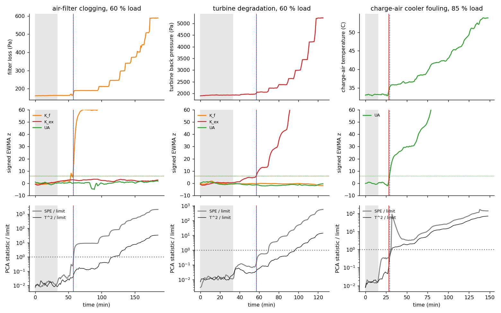
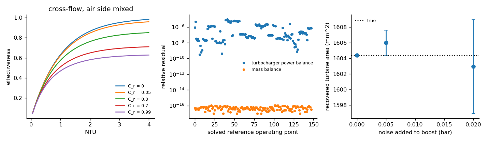
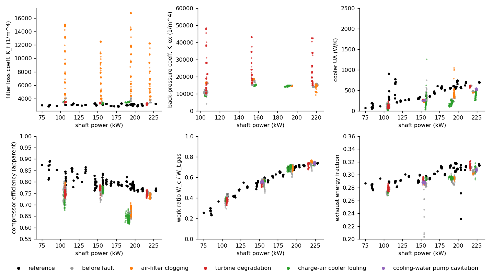
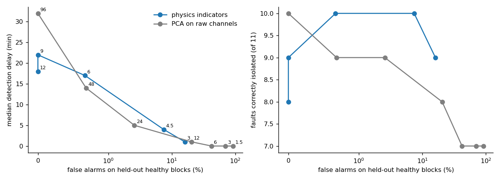
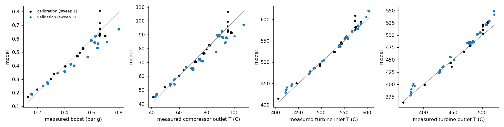
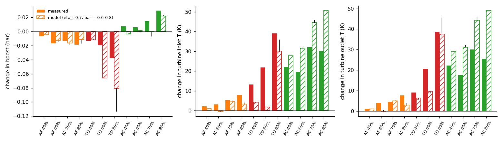

# Turbocharger & Charge-Air Cooler Diagnostics from Test-Bench Data

Real measurements from a turbocharged marine diesel engine on a test bench (Matsui MU323DGSC, open dataset with
deliberately induced faults) are used to answer three questions a turbocharging test engineer faces:

1. **Can the condition of the air filter, the turbine side and the charge-air cooler be read from ordinary bench
   sensors?** Physics-based health indicators (loss coefficients, cooler UA, work balance) are computed from the
   measured temperatures, pressures and flows.
2. **How early, and how reliably, are developing faults detected and told apart?** The indicators are compared with
   a standard data-driven monitor (PCA with T^2 and SPE) on the same data, at the same false-alarm rate.
3. **Does a mean-value engine/turbocharger model calibrated on healthy data predict how the engine responds to
   each fault?** The model reuses the turbine nozzle law of Project 1 and is checked against the measured changes
   in boost and exhaust temperatures.

## In short

| Result | Number |
|---|---|
| Detection, physics indicators (alarm limit 6 sigma) | **11 of 11 faults found, 10 of 11 correctly named**, 0.7 % false alarms on held-out healthy data, median 17 min after onset |
| Detection, PCA on 23 raw channels, same false-alarm rate (0.7 %) | 11 of 11 found, 9 of 11 named, median 14 min |
| Size of the fault when the alarm comes (median) | air filter **+70 Pa** extra loss (physics) vs +132 Pa (PCA); exhaust back pressure **+136 Pa** vs +289 Pa |
| Cooling-water pump cavitation (not a turbocharger fault) | no physics alarm, as intended; PCA alarms on both runs and calls one of them cooler fouling |
| Mean-value model, unseen healthy load sweep | boost within **0.06 bar** (rms), turbine inlet temperature within **6 K**, compressor outlet within 5 K |
| Model vs measurement under turbine back-pressure | boost drop right in sign, 0.9-3.5x the measured size; turbine inlet temperature rise **under-predicted (2-30 K vs 13-39 K)** |
| Data findings | 3 mislabelled units, one derived (not measured) mass flow, 5,400 logger overflow values, an unusable cooler water side |

The two monitoring methods end up close in detection speed. The physics indicators have two practical advantages:
each alarm points to one component, in physical units ("filter loss coefficient +45 %", "cooler UA -40 %"), and
the air-filter and exhaust-side indicators carry over between test days to within 10-30 %, so a baseline does not
have to be re-learned for every load. The PCA monitor reacts earlier to cooler fouling, which shows up in many
temperatures at once. The model result is a useful negative one: a mean-value model gets boost and temperatures
right on healthy data but misses most of the exhaust-temperature rise when the turbine back pressure goes up. The
missing physics (more hot residual gas and pumping work in the cylinders) is exactly what the crank-angle model of
Project 1 resolves.



## Data

Marine Engine Fault dataset, Zenodo [10.5281/zenodo.19857425](https://doi.org/10.5281/zenodo.19857425)
(BahooToroody, Bondarenko, Abaei, Niki, Zio, 2026; CC BY 4.0). A 3-cylinder four-stroke engine with a water brake,
about 70 channels at 2 s. One 12-hour reference file with two load sweeps (60-240 kW), and 15 fault runs of 2-3 h,
each starting healthy and then with the fault introduced in steps:

| Fault | How it was introduced | Loads |
|---|---|---|
| air-filter clogging | filter surface covered step by step (filter loss 160 -> 600 Pa) | 40 / 60 / 75 / 85 % |
| turbine degradation | back-pressure valve after the turbine (2,000 -> 5,300 Pa at 60 %) | 40 / 60 / 85 % |
| charge-air cooler fouling | cooling condition degraded (charge-air temperature +9 to +21 K) | 40 / 60 / 75 / 85 % |
| cooling-water pump cavitation | air injected into the pump suction | 60 / 85 % |

Injector-nozzle runs have no healthy segment and are not used. `python scripts/get_data.py` downloads and checks the
archive (md5). Data are averaged in 60 s blocks.

**What the data audit found** (`scripts/independent_checks.py`, each reproduced from the dataset's own derived
channels):

* *Fuel Flow* is kg/h, not m3/h: Total Input Energy = 11.6 x Fuel Flow exactly (41.76 MJ/kg). With kg/h the brake
  specific fuel consumption is 0.266 kg/kWh, a sensible value for this engine size.
* *Total Input Energy* is kW, not W (Shaft Power / Total Input Energy = Effective Efficiency to 2e-8).
* *Exh. Gas Mass Flow* is **not measured**: it equals 0.0015408 x speed x receiver pressure / receiver temperature
  (coefficient of variation 0.5 %), a speed-density estimate with fixed volumetric efficiency. All mass flows here
  inherit that assumption.
* The files contain 5,436 logger overflow values (999), almost all in the turbine-outlet temperature; they are removed.
* The cooler's water side does not balance its air side: water-side heat is 3.3x the air-side heat at low load and
  0.9-1.2x at high load, and during the fouling runs it climbs to 400 kW against 10-20 kW on the air side. The water
  outlet temperature and flow do not describe the heat exchanged, so only air-side quantities are used.
* The bench's own energy ledger (shaft + coolant + oil + charge-air cooler + turbocharger oil + exhaust + other)
  accounts for 88 % of the fuel energy (median; 79-109 %); "Other Loss" is zero in most samples, so it is not a
  balancing term.

## Method

### Health indicators (`src/tcdiag/indicators.py`)

Each indicator removes the first-order effect of load through a physical law:

| Indicator | Definition | Component |
|---|---|---|
| filter loss coefficient K_f | dp_filter rho_1 / m_air^2 (quadratic loss; fitted exponent on the reference data 2.02) | air filter |
| back-pressure coefficient K_ex | dp_after-turbine rho_5 / m_exh^2 | turbine / exhaust side |
| cooler UA | NTU from the air-side effectiveness (cross-flow, air mixed) x C_air, water capacity from the measured flow | charge-air cooler |
| compressor efficiency | isentropic, inlet = engine-room temperature (so "apparent") | compressor |
| work ratio WR | compressor power / turbine gas enthalpy drop | turbocharger heat loss and bearings |
| exhaust energy fraction | m_exh cp (T_turbine-in - T_receiver) / fuel energy | combustion and heat rejection |

### Detection and isolation (`src/tcdiag/detect.py`)

Each run is monitored against its own first stretch of healthy operation (the first 60 % of its pre-fault blocks);
the rest of the healthy blocks measure false alarms. This is how a bench test or a commissioning baseline works,
and it is necessary here because the cooler UA of the same healthy engine varies by a factor of 4 between test days
(cooling-water temperature and controller state are not logged).

* **Physics**: standardised indicator residuals, EWMA (lambda 0.3), **one-sided** in the only direction the physical
  fault can push them (a clogged filter or a restricted exhaust can only raise a loss coefficient, fouling can only
  lower UA), alarm after 3 consecutive blocks above the limit. The alarming indicator furthest above its limit
  names the fault.
* **PCA**: 23 standardised raw channels, components to 90 % variance, Hotelling T^2 and SPE with the same EWMA and
  persistence. The fault is named from the channel with the largest SPE (or T^2) contribution.
* Both are tuned by one rule (limit = factor x 99.5 % quantile of the training statistic) and compared over the
  whole range of limits and at matched false-alarm rate.

### Mean-value engine and turbocharger model (`src/tcdiag/mvem.py`)

Inputs: speed, fuel flow, engine-room temperature, receiver temperature, filter loss, turbine back pressure. The
boost pressure is solved so that the turbine shaft power equals the compressor power:

* air flow by speed-density (as in the dataset); compressor from the pressure ratio and an efficiency closure;
* turbine inlet temperature from the exhaust energy fraction (linear in power, speed, fuel-air ratio);
* turbine = equivalent nozzle of area A_t (the Project 1 orifice law) giving the inlet pressure p4, shaft power
  eta_t m cp T4 (1 - (p5/p4)^k), turbine outlet temperature from the measured work ratio (the uninsulated turbine
  loses heat: the gas gives up 1.3-3x the shaft work);
* the highest stable root of the power balance is the operating point.

Closures are robust least-squares fits on healthy steady blocks (9 of 148 dropped as outliers in the exhaust energy
fit). Without a turbine-inlet pressure measurement, A_t and the turbine efficiency are **not separately
identifiable**: fitted together their estimates are 99.8 % correlated and eta_t runs to its bound. So eta_t is fixed
(0.6 / 0.7 / 0.8 at 150 kW, with a fitted load slope) and A_t is calibrated on the measured boost of the first load
sweep. The second sweep is the validation.

## Verification

| Check | Result |
|---|---|
| Orifice law vs closed-form choked flow and isentropic subsonic flow | 0 and 9e-16 relative error |
| Effectiveness-NTU inversion, 400 points incl. C_r -> 0 | round trip to 5e-14 |
| Compressor efficiency round trip | 1e-15 |
| Model, 148 solved operating points | turbocharger power balance closed to **9e-6**, mass balance (exhaust = air + fuel) to **1e-16** |
| Calibration on synthetic boost data with known A_t (1,604.4 mm^2) | recovered 1,604.4 (no noise), 1,606.0 +- 0.8 (0.005 bar noise), 1,602.9 +- 3.0 (0.02 bar) |
| Detector on 60 synthetic ramps (20 per indicator) | 0 alarms before onset, 60 of 60 correctly named |
| Independent hand calculation (pandas only) of one point | compressor efficiency 0.8353 and K_f 2,946 in both |
| Dataset's derived channels reproduced | shaft power = torque x speed (2e-5), turbocharger power = 1.06 m dT, mass flow = speed-density |

8 automated tests in `tests/` (orifice choking, effectiveness-NTU limits, indicator definitions by hand, unit and
sentinel cleaning, model mass and power balance, model response to back pressure, end-to-end detection of one
fault run).



## Results

### Indicators, and what carries over between test days



Healthy value in each fault run (before the fault) divided by the healthy reference trend:

| Indicator | Median | Range over 13 runs |
|---|---|---|
| filter loss coefficient | 1.14 | 1.07 - 1.32 |
| back-pressure coefficient | 1.01 | 0.73 - 1.21 |
| work ratio | 0.98 | 0.94 - 1.03 |
| exhaust energy fraction | 0.97 | 0.95 - 1.00 |
| compressor efficiency (apparent) | 0.92 | 0.84 - 0.97 |
| cooler UA | 0.58 | **0.21 - 0.94** |

The loss coefficients and the energy ratios transfer between days and loads; the cooler UA does not, because the
cooler sits in a water loop whose temperature and control action change from day to day and are not logged. The
apparent compressor efficiency is too high at low load (above 0.9) because the engine-room temperature is not the
true compressor inlet temperature; it is reported, not used for isolation.

### Detection and isolation



| Fault run | Physics: delay, named as, size at alarm | PCA (matched false alarms): delay, named as |
|---|---|---|
| air filter 40 % | 19 min, air filter, +70 Pa filter loss | 31 min, air filter (+106 Pa) |
| air filter 60 % | 0 min, air filter, +7 Pa (first step) | 1 min, air filter (+19 Pa) |
| air filter 75 % | 19 min, air filter, +86 Pa | 35 min, air filter (+158 Pa) |
| air filter 85 % | 17 min, air filter, +69 Pa | 32 min, air filter (+167 Pa) |
| turbine 40 % | 23 min, turbine, +147 Pa back pressure | 34 min, turbine (+329 Pa) |
| turbine 60 % | 0 min, turbine, +69 Pa | 13 min, turbine (+289 Pa) |
| turbine 85 % | 0 min, turbine, +136 Pa | 3 min, turbine (+169 Pa) |
| cooler 40 % | 15 min, **air filter (wrong)**, +1.1 K charge air | 14 min, unclear (oil temperature) |
| cooler 60 % | 98 min, cooler, +24 K | 38 min, unclear (cylinder 2 exhaust temperature) |
| cooler 75 % | 90 min, cooler, +13 K | 2 min, cooler (+2.1 K) |
| cooler 85 % | 1 min, cooler, +1.9 K | 3 min, cooler (+2.6 K) |
| pump cavitation 60 % | no alarm | alarm at 53 min, named cooler |
| pump cavitation 85 % | no alarm | alarm at 66 min, unclear |

Over the whole range of limits the two methods trace similar delay vs false-alarm curves (left); the physics
indicators name the fault correctly more often at low false-alarm rates (right). Physics misses: the 40 % cooler
run is named "air filter" (the cooler's water controller is cycling at this load and UA swings by +-50 %), and the
60 % and 75 % cooler runs are caught late (90-98 min, after a 13-24 K rise in charge-air temperature), because UA
drops slowly while the water controller opens. PCA catches those two earlier through the many temperatures that move
together, but names only the 75 % one, and it cannot name the 40 % run either. For the filter and the turbine side
the physics indicators alarm at about half the fault size PCA needs.

### Model on healthy data



| eta_t (at 150 kW) | A_t (mm^2) | Boost rms / bias (bar), validation | T compressor out | T turbine in | T turbine out |
|---|---|---|---|---|---|
| 0.6 | 1,491 | 0.056 / -0.034 | 4.9 K | 5.8 K | 10.7 K |
| **0.7** | **1,628** | **0.059 / -0.036** | **5.2 K** | **6.0 K** | **11.3 K** |
| 0.8 | 1,830 | 0.075 / -0.064 | 6.6 K | 7.9 K | 17.0 K |

Calibration errors on the first sweep are similar (0.04 bar, 3.5 / 8.3 / 9.1 K at eta_t 0.7). The choice of eta_t
moves A_t by 23 % but the predictions by little, which is the practical meaning of the non-identifiability.

### Model vs measured fault response

Change between the healthy start and the last 10 minutes of each run; the model gets the measured fault inputs
(filter loss, back pressure, receiver temperature) and nothing else.



| Run | Fault input | Boost change, measured / model (bar) | Turbine inlet T change, measured / model (K) |
|---|---|---|---|
| air filter 40 % | +304 Pa | -0.007 / -0.004 | +2.2 / +0.9 |
| air filter 60 % | +425 Pa | -0.017 / -0.013 | +3.1 / -0.4 |
| air filter 75 % | +824 Pa | -0.013 / -0.017 | +5.2 / +4.8 |
| air filter 85 % | +764 Pa | -0.019 / -0.011 | +7.8 / +3.2 |
| turbine 40 % | +2,216 Pa | -0.013 / -0.012 | +13.2 / +4.3 |
| turbine 60 % | +3,129 Pa | -0.019 / -0.066 | +21.9 / +1.8 |
| turbine 85 % | +5,609 Pa | -0.038 / -0.081 | +39.1 / +30.1 |
| cooler 40 % | +9.3 K charge air | +0.007 / -0.003 | +22.1 / +28.0 |
| cooler 60 % | +12.7 K | +0.006 / +0.001 | +19.6 / +31.5 |
| cooler 75 % | +17.6 K | +0.015 / -0.001 | +32.0 / +44.7 |
| cooler 85 % | +20.6 K | +0.030 / +0.022 | +30.2 / +50.6 |

For the air filter the model is right to within the measurement scatter. For the turbine back pressure it
over-predicts the boost loss and badly under-predicts the exhaust-temperature rise: in the model the only route from
back pressure to exhaust temperature is the smaller air flow, while in the engine the higher exhaust pressure also
keeps more hot residual gas in the cylinders and adds pumping work. For the cooler it over-predicts the
exhaust-temperature rise by about 1.5x (hotter charge air is partly compensated in the real engine). The spread
across eta_t = 0.6-0.8 is at most 6 K and 0.03 bar, so these conclusions do not depend on the fixed efficiency.

## Limitations

* **Mass flow is not measured** (speed-density with a fixed volumetric efficiency), ambient pressure was not
  logged (101.325 kPa assumed) and turbine-inlet pressure was not measured. These set what can be identified: turbine
  efficiency and flow capacity only together.
* One run per fault and load; detection statistics are over 11 runs, so one run changes a percentage by 9 points.
* "Turbine degradation" is emulated by a valve after the turbine; it is really an exhaust restriction, and the
  back-pressure coefficient sees it directly. Real blade fouling or erosion would act through the turbine's flow
  capacity and efficiency, which these sensors cannot separate.
* The monitoring baseline is per run (start of each test). Across days, only the loss coefficients and energy
  ratios transfer; the cooler needs water-loop temperature and controller logging.
* The mean-value model has no gas-exchange physics; a crank-angle model (Project 1) calibrated on these data would
  be the next step, using the in-cylinder peak pressures that are in the dataset but not used here.

## Files

| Path | Content |
|---|---|
| `src/tcdiag/io.py` | loading, unit corrections, sentinel removal, 60 s blocks, steady-state filter |
| `src/tcdiag/thermo.py` | gas relations, orifice (nozzle) law, compressor relations, cross-flow effectiveness-NTU |
| `src/tcdiag/indicators.py` | the six health indicators |
| `src/tcdiag/detect.py` | physics and PCA monitors, isolation |
| `src/tcdiag/mvem.py` | mean-value engine and turbocharger model, calibration |
| `scripts/get_data.py` | download and checksum of the dataset |
| `scripts/run_verification.py` | closed-form checks, model balances, synthetic recovery, synthetic faults |
| `scripts/run_analysis.py` | indicators, detection comparison, model calibration, validation and fault response |
| `scripts/independent_checks.py` | data audit and hand calculations without the package |

## Run (Python 3.11+, numpy, scipy, pandas, matplotlib)

```bash
python scripts/get_data.py              # 27 MB download
python scripts/run_verification.py      # about 1 min
python scripts/run_analysis.py          # about 4 min
python scripts/independent_checks.py    # a few seconds
python -m pytest -q tests
```

Data: BahooToroody A., Bondarenko O., Abaei M. M., Niki Y., Zio E. (2026), *Marine Engine Fault Dataset*,
Zenodo, doi:10.5281/zenodo.19857425, CC BY 4.0. References: Incropera et al., *Fundamentals of Heat and Mass
Transfer* (cross-flow effectiveness-NTU); Heywood, *Internal Combustion Engine Fundamentals* (turbocharger
relations); MacGregor & Kourti (1995), *Statistical process control of multivariate processes* (T^2 / SPE).
